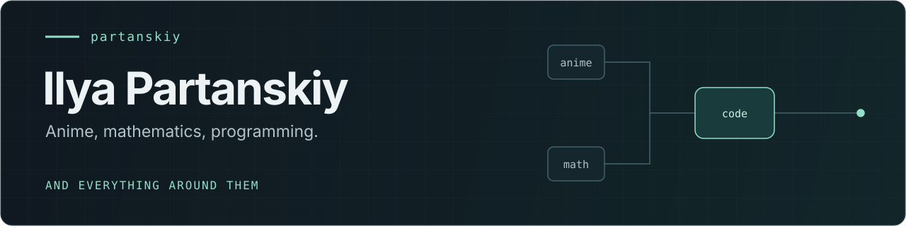

<b>English</b> | <a href="README.ru.md">Русский</a>

<picture>
  <source media="(max-width: 600px) and (prefers-color-scheme: light)" srcset="assets/header-mobile-light.svg">
  <source media="(max-width: 600px)" srcset="assets/header-mobile-dark.svg">
  <source media="(prefers-color-scheme: light)" srcset="assets/header-light.svg">
  
</picture>

  
  
  
  
  

## About me

I'm Ilya. I like **anime, mathematics, and programming**, and everything around them.

I work as a backend engineer at Yandex, currently on [neurolegal](https://neurolegal.ya.ru/).

[My projects](https://github.com/partanskiy?tab=repositories) |
[Mathematics materials](https://github.com/partanskiy/teaching)
