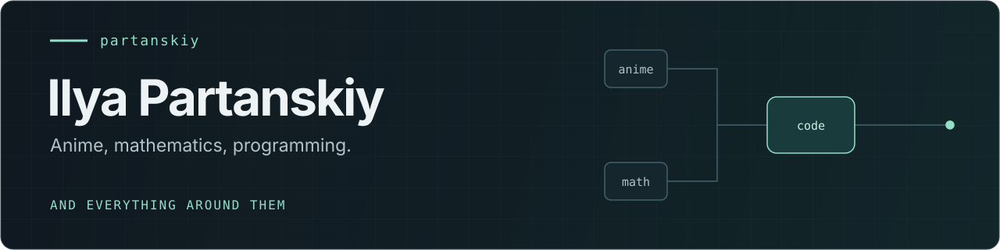

<a href="README.md">English</a> | <b>Русский</b>

<picture>
  <source media="(max-width: 600px) and (prefers-color-scheme: light)" srcset="assets/header-mobile-light.svg">
  <source media="(max-width: 600px)" srcset="assets/header-mobile-dark.svg">
  <source media="(prefers-color-scheme: light)" srcset="assets/header-light.svg">
  
</picture>

  
  
  
  
  

## Обо мне

Я Илья. Люблю **аниме, математику и программирование**, вместе со всем, что вокруг них.

Работаю бэкенд-разработчиком в Яндексе, сейчас над [neurolegal](https://neurolegal.ya.ru/).

[Мои проекты](https://github.com/partanskiy?tab=repositories) |
[Материалы по математике](https://github.com/partanskiy/teaching)
